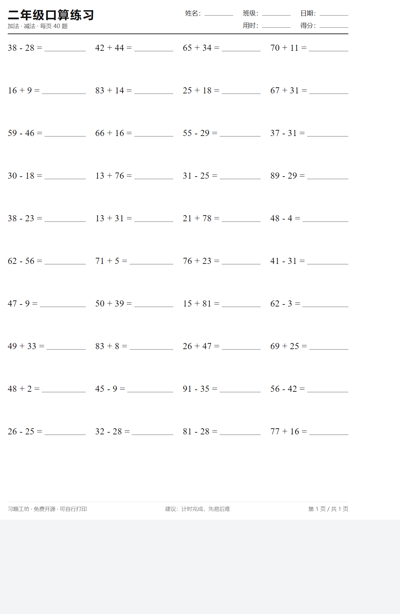
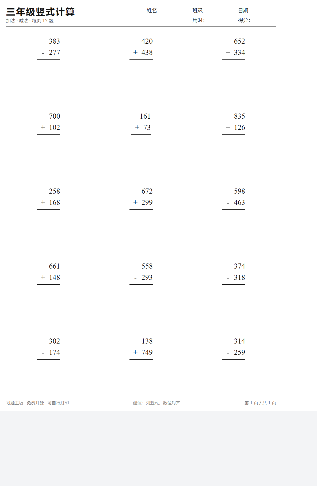
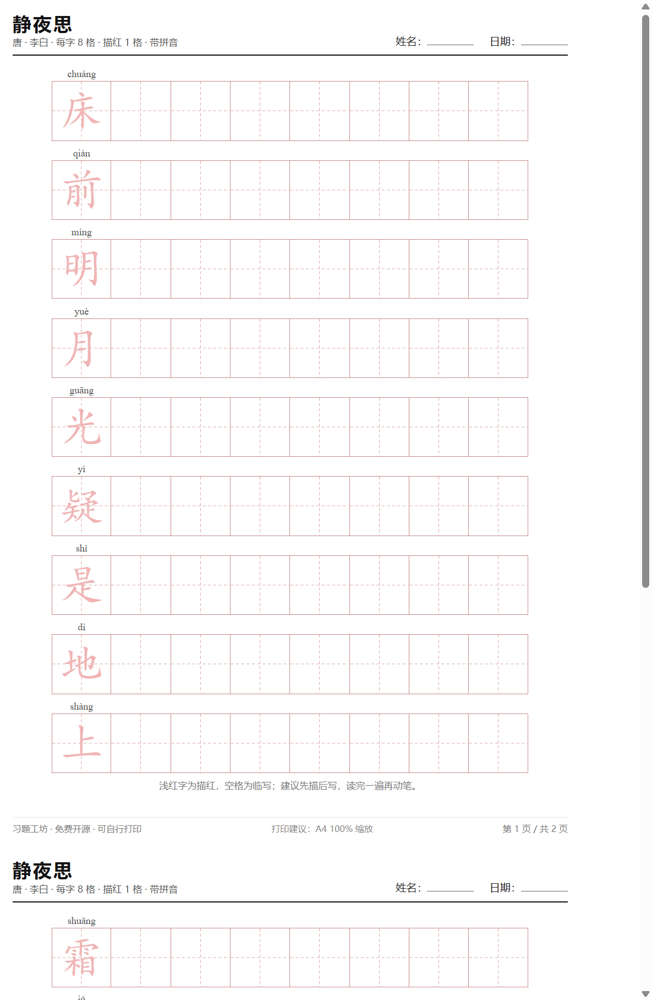
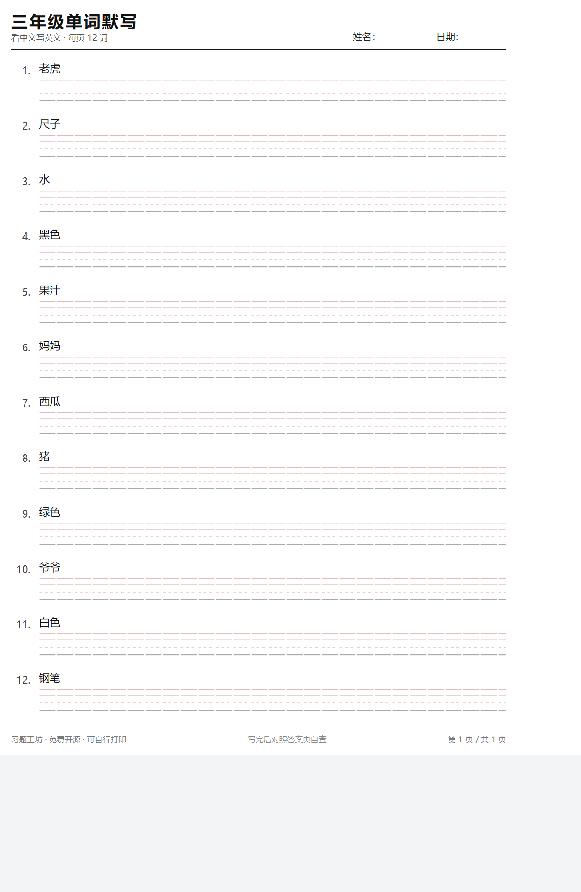
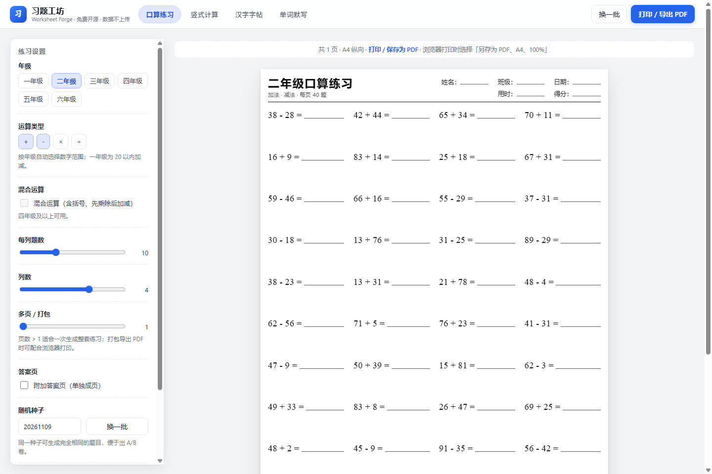

# 习题工坊 · Worksheet Forge

> 免费、开源、纯前端的小学练习卷生成器：**口算练习 / 竖式计算 / 汉字字帖 / 英语单词默写**，A4 一键打印，数据不上传。

[](LICENSE)
[](#快速开始)
[](#隐私与安全)

**在线使用：** https://1399446233.github.io/worksheet-forge/ （部署后替换为真实地址）

---

## 为什么做这个

老师出卷、家长找题，常见做法是下载一份固定 PDF，或者手工抄题。孩子的练习需求却一直在变：今天错在进位，明天错在除法竖式；一个班 40 个孩子，程度还不一样。

习题工坊把「出卷」变成 30 秒的事：选年级、选题型、点打印。**题目由本地算法即时生成，答案自动计算**，想要几页就几页；全程离线，孩子的姓名、出生信息、成绩一个字节都不会离开电脑或手机。

## 功能一览

| 模块 | 能做什么 |
| --- | --- |
| **口算练习** | 1–6 年级按难度生成加减乘除，可开关「混合运算（含括号、先乘除后加减）」「有余数除法」；自定义每列题数、列数、页数；答案单独成页 |
| **竖式计算** | 加、减、乘竖式，自动对齐数位并留出完整作答空间；适合低中年级笔算训练 |
| **汉字字帖** | 粘贴任意课文 / 生字表，或选内置古诗与常用字；生成描红 + 田字格 / 米字格字帖，自动标注拼音；重复字自动去重 |
| **英语单词默写** | 内置小学 3–6 年级 200 个基础词，也可粘贴自定义词表；看中文写英文（四线三格）或看英文写中文；答案页单独输出 |

其他：

- **随机种子**：同一种子生成完全相同的卷子，方便出 A/B 卷、对照卷。
- **A4 打印优化**：矢量文字，300dpi 打印清晰；每页自带姓名 / 班级 / 日期 / 用时 / 得分栏。
- **多页打包**：一次生成几十页，浏览器「打印 → 另存为 PDF」即可得到整本练习册。
- **纯静态**：一个 `index.html`，无构建、无后端、无数据库、无第三方接口。

## 截图

| 口算练习 | 竖式计算 |
| --- | --- |
|  |  |

| 汉字字帖 | 单词默写 |
| --- | --- |
|  |  |

界面预览：



## 免费样张（可直接打印）

不想自己设置参数？这里有几份已经生成好的 A4 样张，点开即可打印：

| 样张 | 说明 |
| --- | --- |
| [一年级口算 3 页（含答案）](samples/样品_一年级口算_3页含答案.pdf) | 20 以内加减法 |
| [三年级竖式 2 页（含答案）](samples/样品_三年级竖式_2页含答案.pdf) | 千以内加减竖式 |
| [古诗字帖 · 静夜思](samples/样品_古诗字帖_静夜思.pdf) | 田字格描红 + 拼音 |
| [四年级单词默写 2 页（含答案）](samples/样品_四年级单词默写_2页含答案.pdf) | 看中文写英文 |

更多同款打印包（按年级整套 PDF）见 [Releases](https://github.com/1399446233/worksheet-forge/releases)；也可以直接用上面的在线版按需生成。

## 快速开始

### 方式一：直接打开（最简单）

1. 下载本仓库（Code → Download ZIP）并解压；
2. 双击 `index.html`，用 Chrome / Edge / Firefox 打开；
3. 选好题型后点右上角 **打印 / 导出 PDF**，打印目标选「另存为 PDF」。

> 首次打开时，字帖的拼音依赖本地的 `assets/pinyin-pro.umd.js`，已随仓库提供，无需联网。

### 方式二：部署成网页

把整个目录原样上传到任意静态托管即可（GitHub Pages / Vercel / Netlify / Nginx），无需任何构建命令。

GitHub Pages 部署：仓库 Settings → Pages → Build and deployment → Source 选 `Deploy from a branch` → 分支选 `main`、目录选 `/ (root)` → 保存，稍等片刻即可通过 `https://<用户名>.github.io/worksheet-forge/` 访问。

### 方式三：命令行批量出 PDF（适合老师 / 机构）

```bash
# Windows 示例：用 Chrome 无头模式把 30 页口算（含答案）打印成 PDF
"C:\Program Files\Google\Chrome\Application\chrome.exe" ^
  --headless=new --disable-gpu --no-pdf-header-footer ^
  --print-to-pdf="一年级口算30页.pdf" ^
  --virtual-time-budget=30000 ^
  "file:///D:/worksheet-forge/index.html?mode=oral&grade=1&pages=30&ans=1&auto=1"
```

`auto=1` 会自动隐藏界面，只输出 A4 页面，适合批量生成。完整参数见下方「URL 参数」。

## URL 参数

所有参数都可以直接拼在地址后面，便于分享、收藏和一键出卷。

| 参数 | 取值 | 说明 |
| --- | --- | --- |
| `mode` | `oral` / `vertical` / `hanzi` / `words` | 模块 |
| `auto` | `1` | 自动模式：隐藏界面，仅渲染页面（用于 PDF 导出） |
| `grade` | `1`–`6` | 年级 |
| `ops` | 如 `%2B-×÷`（即 `+-×÷` 的子集） | 参与的运算；建议直接使用年级默认值 |
| `mix` | `1` | 混合运算（4 年级起） |
| `rem` | `1` | 有余数除法（4 年级起） |
| `cols` / `rows` | 整数 | 列数 / 每列题数（竖式为每列竖式数） |
| `pages` | `1`–`60` | 生成页数；`>1` 即为多页练习册 |
| `ans` | `1` | 附加答案页 |
| `seed` | 整数 | 随机种子，同种子同题目 |
| `header` | `0` | 隐藏姓名 / 日期栏 |
| `title` | 文本 | 自定义标题 |
| `preset` | `jingyesi` 等 | 字帖内置古诗 id（见 `data/presets.js`） |
| `text` | 文本 | 字帖自定义内容（URL 编码），会覆盖预设 |
| `hrows` / `cells` | 整数 | 字帖每页行数 / 每行格数 |
| `trace` | `0`–`3` | 每字描红格数 |
| `grid` | `tian` / `mi` / `none` | 田字格 / 米字格 / 空白格 |
| `py` | `0` | 隐藏拼音 |
| `dedupe` | `0` | 关闭去重 |
| `list` | `grade3`–`grade6` / `all` | 单词默写内置词表 |
| `dir` | `cn2en` / `en2cn` | 默写方向 |
| `per` | `6`–`13` | 每页词数 |
| `custom` | 文本 | 自定义词表，每行 `apple 苹果` |

示例：

```text
index.html?mode=oral&grade=3&cols=4&rows=10&pages=20&ans=1&auto=1
index.html?mode=hanzi&preset=chunxiao&hrows=9&cells=8&trace=1&auto=1
index.html?mode=words&list=grade5&dir=cn2en&per=12&pages=10&ans=1&auto=1
```

## 打印建议

- 纸张：**A4 纵向**；缩放：**100%**（不要选「适应页面」）；页边距：默认。
- 浏览器打印对话框里勾选「背景图形」（如需要田字格红线），并关闭「页眉和页脚」。
- 黑白打印机也可正常使用：田字格会打印为浅灰色线条。

## 隐私与安全

- 全部计算在浏览器本地完成，**没有后端、没有统计脚本、没有远程字体或 CDN 依赖**。
- 输入的文字、词表、姓名栏内容不会被保存或发送；刷新即清空。
- 断网可用（下载后本地打开）。

## 目录结构

```text
worksheet-forge/
├─ index.html                # 应用入口（单页）
├─ assets/
│  ├─ app.js                 # 界面状态、控件、URL 参数
│  ├─ generate.js            # 题目生成算法（可复现随机、混合运算、竖式）
│  ├─ render.js              # A4 版面渲染（四类练习卷与答案页）
│  ├─ style.css              # 界面与打印样式
│  └─ pinyin-pro.umd.js      # 拼音库（MIT，本地引入）
├─ data/
│  ├─ words.js               # 内置小学英语词表
│  └─ presets.js             # 字帖预设（公版古诗、基础字）
├─ docs/
│  ├─ 使用说明.md
│  ├─ 开发者说明.md
│  └─ images/                # 截图
├─ LICENSE
└─ README.md
```

## 开发与扩展

这是一个**零构建**项目：改完 JS/CSS 刷新页面即可。新增一类题目的大致步骤：

1. 在 `assets/generate.js` 增加出题函数，返回 `{expr, ans}` 或竖式结构；
2. 在 `assets/render.js` 增加对应的渲染函数（可参考 `buildOral` / `buildVertical`）；
3. 在 `assets/app.js` 的 `DEFAULTS`、`renderControls`、`buildPages` 分支中登记。

更细的接口说明见 [docs/开发者说明.md](docs/开发者说明.md)。

## 常见问题

**Q：题目难度准吗？**
按年级粗略分档（一年级 20 以内加减、二年级表内乘除与 100 以内加减、三年级千以内加减与两三位数乘除……）。算法保证不出现负数结果，除法保证整除（勾选「有余数除法」时答案带余数）。如果你需要按教材版本精确对齐，可以在 `generate.js` 里改数字范围，几十行即可。

**Q：能商用吗？**
代码与生成的题目内容均以 MIT 协议开源，可自由用于课堂教学、机构教学与二次开发；字帖预设使用公有领域古诗。请勿把本项目包装成「官方教材配套」或宣称提分效果。

**Q：手机能用吗？**
界面自适应，手机上可以设置和预览；打印建议在电脑上操作。

**Q：为什么不做题库？**
固定题库会很快刷完，且容易变成「背答案」。生成式按需出题更能覆盖薄弱点，也更适合不同教材版本。

## 参与贡献

欢迎提 Issue 反馈题目难度、排版问题或新题型需求；Pull Request 请保持「零构建、纯前端、无第三方依赖」的原则，并附上一张打印预览截图。

## 许可证

[MIT](LICENSE) © 2026 Worksheet Forge contributors

字帖内置古诗均为公有领域作品。项目由 AI 辅助开发（DeepSeek Harness），所有练习内容由算法原创生成，不包含任何教材扫描件或受版权保护的教辅内容。
